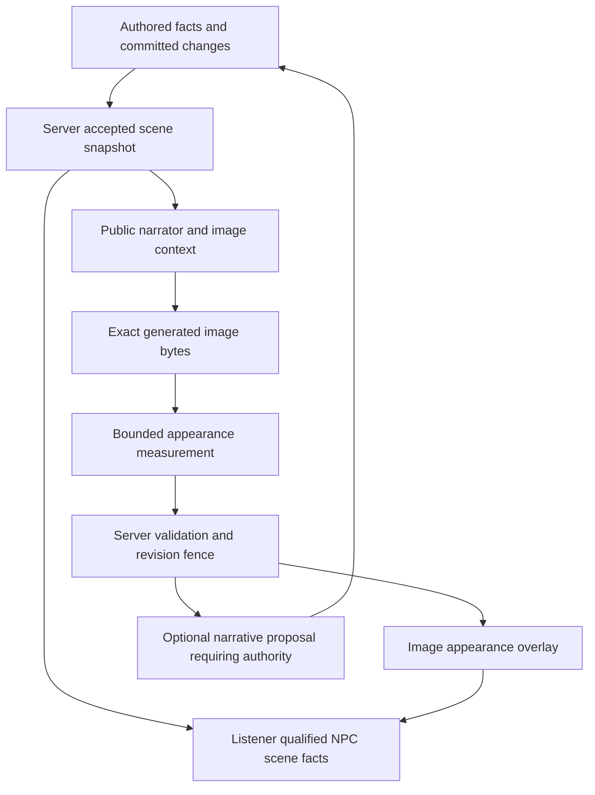

# Proposal: two-pass scene observation hydration

Date: 2026-10-16. Planning only, grounded in source `30a4857ab698dded5b06440a16ce850b50bfa786` and FUTERA playtest evidence. No source edits, prototype, provider research/calls, builds or runtime actions were authorized or performed by this task.

## Intended result

Before prose and imagery are generated, establish the permitted scene people, objects and observable state once. After a plate is rendered, measure how that exact image depicts those entities. Feed qualified observations back into narration and NPC scene answers while preserving the distinction between story truth and the rendered picture.

“Two-way” means feedback between scene state and its presentation. It must not let an image establish a new employer, object ability, clue, offscreen event, intent, destination, identity, injury or rules outcome. The narrator expresses approved scene facts; it is not a second authority database.

The last arrow is an explicit separate accepted story change, never an automatic merge of image output.

## What already exists

| Responsibility | Current reusable source / behavior | Current gap |
| --- | --- | --- |
| Shared scene entities | `adventure/scene_model.rs`: SceneModel, ScenePerson, SceneThing, SceneKnowledge, SceneNow, SceneChange; stable IDs and current object state | Fixed harbor has no model. Generated model has fixed cardinality/knowledge requirements; sparse authored scenes need an explicit contract choice. |
| Authoring before prose | `adventure/setting.rs:368–387` builds deterministic models before narration. `adventure/generate.rs:618–627` supplies scene.model; `adventure/expression.rs:555` projects narration appearance context | The generated path exists; current fixed harbor bypasses it. Schema/prompt and validate_candidate exist, but no active general model-generation call was found. Do not claim it is already a running hydration service. |
| Canonical current state | `journey/living_scene.rs:92`: replayable committed interaction journal -> SceneNow; server owner publishes detached presentation copies | No model means no snapshot; caches must not become a second durable truth store. |
| Public projections | SceneModel.picture_state (287) excludes private knowledge and closer-look results; public_contents supplies permitted entity actions; npc_room::facts filters against Withheld | No-dossier NPC context lacks this shared room basis. Full prompt_context serializes more than the public projection; never send it wholesale to a public NPC or image job. |
| Picture from same model | `imagery/scene_prompt.rs:29` model_plate; state_edit / graph_edit. `imagery/photo_edit.rs:25` harbor_photo_edit optionally receives canonical picture state | Harbor without model falls back to photo/reference and shot vocabulary. Appearance can exceed the semantic entity catalog. |
| Public scene graph | `scene_graph.rs`: scene_key/revision, public actors, positions and visible_state; with_model replaces decorative staging with accepted model | Composition graph is not evidence of NPC perception or mechanics. Current retained harbor view has scene_graph null. |
| Image and cache lifecycle | `imagery.rs`: ImageKey, complete cached bytes, admitted mode, concurrency owner, provenance manifest, typed failures; plates.rs tracks accepted render generations | ImageKey is a hash of request/schema/model/quality/rating/prompt/reference hashes (`request_key`, 1145), **not a digest of returned image bytes**. Byte binding must be added explicitly to observation metadata. |
| Post-image measurement | `df-providers/src/head_locate.rs`: one bounded OpenAI multimodal call, known target IDs -> boxes; `imagery.rs:422` reads exact cached image, downscales, shares permits; plates.rs stores placement notes and validates locator revision/identity reference hashes | Only head boxes are returned. There is no existing general scene-description/observation API. A broader structured adapter is a new contract, not an available tool to invoke today. |
| Diagnostics | HeadDiagnostic and actor-head logs, image keys/prompt/reference hashes, render diagnostics, CLI timeline and display effective-source IDs | Need joined scene-basis/image-byte/access provenance and terminal hydration outcomes. |

## Pass 1: authoritative scene preparation

1. The session owner obtains authored scene/content revision, current canonical actors/party and replayed SceneChange state. Construct or load a bounded accepted entity snapshot before narrator expression and image dispatch. Fixed packs need explicit authored entity rows as generated packs already have; the Courier's packet must be registered here, not discovered from the image afterward.
2. Bind the snapshot to run generation, scene identity, place, content/policy revision and relevant committed state/scene revision. Track a digest of the public semantic projection; do not invalidate for an unrelated private fact or harmless narration change.
3. Project separate consumers from that basis:
   - Narrator: permitted scene facts and current committed outcomes, with hidden discoveries excluded.
   - Image: appearance/position/state only, using picture_state or a reviewed public projection. Never private names, knowledge tiers, undiscovered closer_look, clue addresses, motives or future beats.
   - NPC: the scene facts that this speaker can perceive or already knows and this answer's listener may receive. Public entity presence is not a grant of hidden knowledge. Preserve source IDs and explicit limits/uncertainty.
   - Investigation: stable targets and authored affordances/finding bindings. A packet exterior can be inspectable without granting an address, opening it or inventing evidence.
4. Narrator may propose flavor or a neutral visual detail only under an approved bounded content policy. New consequential objects/claims stay rejected or staged for explicit server narrative/world validation. Prose must not silently expand the entity catalog.
5. Keep the stable scene snapshot separate from the latest display paragraph/check result. A wharf check may update narration without replacing the scene's people and objects.

Do not fill SceneModel's current 4–6 object and three-knowledge-entry quotas with invented material. Before implementation select either a complete reviewed harbor model or a narrow sparse-authored-model contract, with save/load validation and ownership agreed.

## Pass 2: measured appearance of an exact ready plate

Admit one optional, run-owned observation job when a complete plate becomes ready. Start with known entity IDs and approved public visual descriptors. Reuse the existing multimodal transport, immutable image-byte loading, permits, typed error patterns and placement cache approach. Preserve head measurement as its own supported operation until a broader contract is explicitly implemented and verified.

Proposed minimal response categories:

| Category | Permitted meaning / consumer |
| --- | --- |
| Known entity visibly located | Matching supplied canonical ID, bounded image region and closed relative position/pose/appearance attributes; used for anchoring and image-qualified description. |
| Known entity not confidently located | Unknown, occluded, out of frame or not measured in this photograph. Never “does not exist” or “NPC cannot see it”. |
| Appearance mismatch | Known public state conflicts with the rendition (e.g. packet omitted/open-looking). Record a presentation defect; preserve canonical object state. |
| Unregistered decoration candidate | Optional bounded proposal for visual background only, with no person identity, clue, text interpretation, affordance or game effect. First implementation may simply reject/omit extras to keep scope narrow. |

No image-only observation directly becomes SceneKnowledge, a KnowledgeGrant, a rules target, a SceneChange or narrative truth. To add a useful story entity, narrative/world must accept a separate source-valid proposal and the session owner must commit it with a new basis. If a player asks about incidental unregistered art, use image-qualified appearance or a clear need-for-ruling response; do not invent the object's purpose or deny authored reality.

Do not infer emotional intent, personal names, affiliation, injury, ownership, unseen contents, object value/use, readable secret text or pursuit history from pixels. Holder/open/broken state remains canonical even when an image appears different. A camera crop is not an NPC's visual field. NPC line-of-sight/witness permissions remain interaction/knowledge policy.

## Required record and fencing

Freeze a minimal private contract before consumers. A proposed appearance record needs:

The scene/session owner must define a dedicated generation for this work. Existing display, media, provider, access and consent generations fence different lifetimes and cannot be substituted for it. Bind the full public projection digest separately from the current short graph fingerprint and effective image-byte digest.

- Run/generation, scene/place identity, content/policy/access revision, relevant scene/public-snapshot digest and entity identity revisions.
- Image request key **and actual encoded-byte SHA-256**, format/dimensions, plus digest of the downscaled vision input if transformed. The original byte digest proves which delivered plate was measured; the vision-input digest proves what the adapter saw.
- Observation schema/model/adapter revision, job/operation ID, admitted execution mode and deadline; source IDs for every accepted observation.
- Known entity ID and bounded appearance fields/boxes, unknown or mismatch result, and audience scope. No free-form authoritative narrative blob.
- Terminal outcome: ready, partial/unknown, unavailable/off, denied budget, failed, cancelled, stale or rejected. These must not masquerade as an empty successful observation.

The session owner verifies the run generation, relevant source/access/identity basis and image digest when accepting completion. The presentation consumer also verifies the observation's image matches the **effective displayed image**, not merely the newest requested plate. Retain old records for replay but never apply an old photograph's placements or descriptions to a new plate. Unrelated private changes must not change a public observation's projection.

## Failure, cadence and feedback rules

- Proposed first implementation: one optional bounded post-image call per distinct image-byte digest + public basis + observation schema/model/identity context. No calls per dialogue token, animation frame, view poll, reconnect, or duplicate image-ready event. Reuse validated cached observations on exact matches.
- Use existing provider admission/budget/mode and image concurrency ownership. A finite deadline comparable to the current 25-second head-location boundary is a proposal to measure and freeze, not a promise that broader observation fits it. Reserve required dialogue/action capacity. No silent prepared-only fallback to live.
- Scene reset/run termination cancels unstarted work and fences any queued completion. New plate bytes or relevant scene/access/identity changes supersede the old demand. A result arriving late is logged stale and cannot alter current text, picture, pending states or game outcomes.
- Missing/failing/off vision leaves canonical scene answers and predicted layout available. It must not block a check, required story beat or the display of a valid plate. Unknown visibility produces no negative fact.
- Contradictions create diagnostics and a source-safe presentation choice. No automatic render-observe-render loop in the first implementation. Any later repair budget must explicitly cap attempts, reserve spend and retain the original evidence; a critic cannot authorize new story facts.
- A public conversation beat that changes only gesture may create a new image, but should not recreate the canonical scene. Appearance feedback never triggers its own identical image regeneration or recursive narration rewrite.
- Save accepted canonical changes in the existing journal. Keep immutable image observations under versioned provenance/replay policy, not an unbounded in-memory global cache. Recover without repeating an unknown paid call.

## Audience and publication controls

- Construct both prompts before dispatch from permitted public fields. Do not pass full dossiers, hidden scene knowledge, undiscovered closer_look, address text, private hero backstories, private conversation, future image branches or the full serialized scene model to a public vision/narration job.
- A private finding remains recipient-scoped even if it suggests a later close-up image. Public plate observation must not receive it as an identity hint. Authorize a separate private asset/observation scope where necessary.
- Public NPC answers can cite accepted public scene presence and qualified visual appearance, filtered for that NPC's perception and current disclosure policy. Existing withheld Identity/Motive/Employer and relationship gates remain authoritative.
- Natural wording must retain supported polarity and uncertainty. A partial list cannot become “nothing else is visible”; an unknown box is not proof of absence. Exact story names/numbers/outcomes use their approved slots/facts. General generated prose remains candidate expression until qualified.

## CLI and observability

Use the shared OTEL path and existing CLI timeline/diagnostic readers; do not create another log owner. Add safe structured events at preparation, admission/cache, request, completion, acceptance/rejection and consumption. Proposed event family `gameplay.scene_observation.*` is a design suggestion, not an existing API.

Each diagnostic should join build/configuration/content/policy revision, hashed run/scene context, relevant state/public-basis digest, image request key, returned-byte digest, vision-input digest, source/effective asset ID, job ID, purpose/schema, stage/status, duration, bounded entity/accepted/unknown/mismatch counts and closed failure/stale reason. Log target IDs/provenance rather than raw image bytes, prompts, player text, private facts or unlimited captions. Record that canonical fallback was used and whether a stale image/context prevented consumption.

CLI read-only output should show: current scene basis, effective image key/hash, hydration status, accepted public entity observations and per-consumer source IDs; separate missing scene model, target not registered, explicit absent, no perception basis, vision unavailable, provider failure, stale completion and deliberate NPC withholding. Current `ATTEMPT thing=...` is classifier text, while `TARGET` is grounding: retain that distinction and add catalog revision/selected stable ID/terminal refusal reason.

## Scope, owners and gates

Suggested sequential work:

1. **Canonical fixed-scene bridge:** content author + scene/interaction owner register harbor packet and current public entities; fix no-model absent handling; project stable no-dossier scene basis. This alone addresses the observed packet gap and much of NPC context without waiting for vision.
2. **Bounded observation-question authority:** NPC owner binds “what can you see / who is here” answers to that basis, preserving uncertainty and existing disclosure behavior.
3. **Post-image appearance contract:** imagery/provider owner freezes typed known-ID observations and byte provenance, uses existing effect owner/fencing/cache, then connects audience-safe NPC/narrator consumers. Review the contract before changing shared wire/persistence types.

Likely connecting paths: `adventure/scene_model.rs`, `adventure/setting.rs`, `adventure/expression.rs`, fixed pack and validation; `journey/living_scene.rs`, `investigation.rs`, `dialogue.rs`, `wire.rs`; `npc_reply.rs`, `npc_facts.rs`, `npc_room.rs`, `npc_answer.rs`; `imagery.rs`, imagery prompt modules, `living_scenes/plates.rs`, `scene_graph.rs`, provider adapter and existing CLI diagnostic readers. These are proposed ownership boundaries, not authorization to edit them during this planning task.

Acceptance must include:

- Actual fixed harbor/no ledger before and after a general check; packet exists independently of image success and both retained inspect sentences resolve it without opening/revealing/creating clues.
- Current Brakka/Sigrun/Courier/Bandit scene facts from canonical sources; no unsupported blanket negative perception, name/motive/pursuit history or image-derived mechanical claim.
- Paired hidden-state cases produce identical public prompts, image/observation selection and public answers. Private recipient followup cannot contaminate the next public reply.
- Faithful adapter fixtures for known IDs/boxes, unknown/occluded, malformed/duplicate/excess output, incidental props, contradictions and suspicious text in images. The output cannot authorize executable instructions.
- Same request key with changed returned bytes invalidates appearance cache; same bytes under changed scene/access/identity basis are requalified. Old frame/new frame, rewind/reset, cancelled jobs, reconnect, duplicate completion and provider-off/failure/timeout have explicit tested outcomes.
- No automatic render loop or extra calls from reconnect; cache/prepared-only/replay produce no live calls. Required mechanics progress with no vision.
- Native/WASM contracts, save/load/replay and two-role live browser/vision/audio acceptance on one fixed source/content/asset revision. Source tests alone cannot demonstrate coherent running perception.

Governing plans: narrative-engine Authoring and state / Realization and acceptance; interaction-engine Persistent social and epistemic model / Intent and affordances / Grounded creative speech; listener-safe claim policy Decision / Boundary and ownership; runtime-reliability Authority / Async / Media; asset-engine Control plane / Lifecycle / Nonblocking presentation; observability Correlation / Runtime director evidence. No new supplier capability, pricing, or model recommendation is asserted by this design. Verify any new production adapter capability separately before implementation.

Workflow SQLite is still zero bytes and was not changed; the coordinator records triage. Companion observed-gap report: `dialogue-playtest-gaps.md`.

## Scene memory representation

The concrete immutable plate history, stable entity binding, three-way merge, packet handoff example, and bounded memory/replay proposal are in [Scene memory representation](scene-memory-representation.md). This is a design extension, not implemented runtime behavior.
